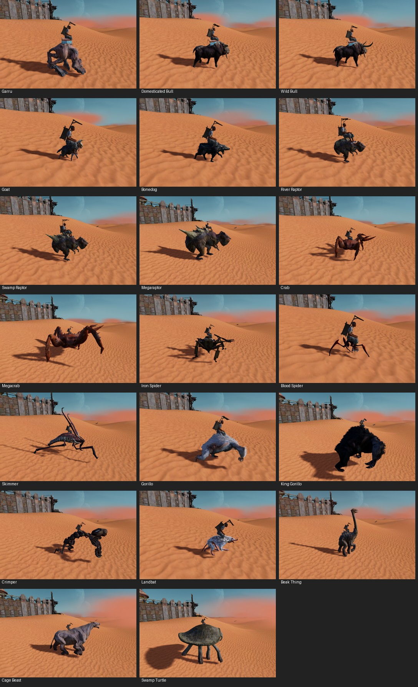
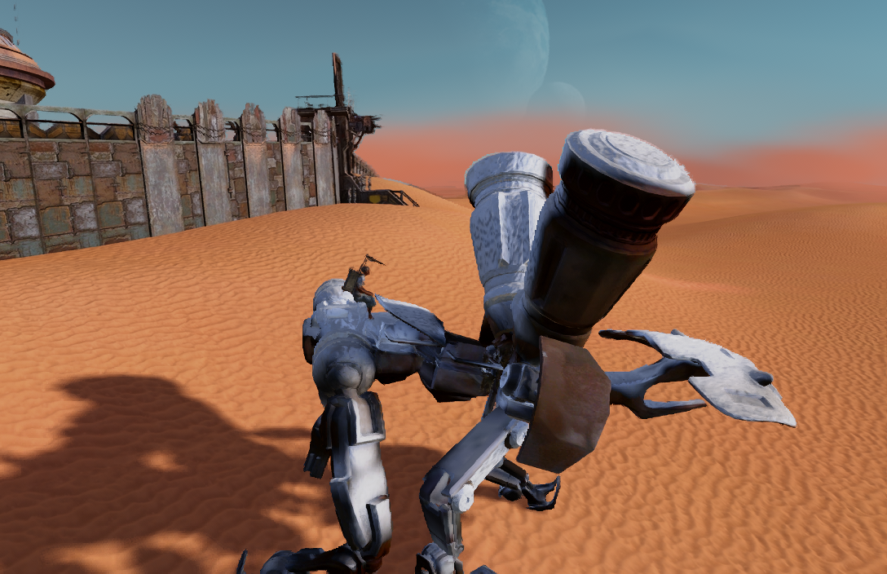
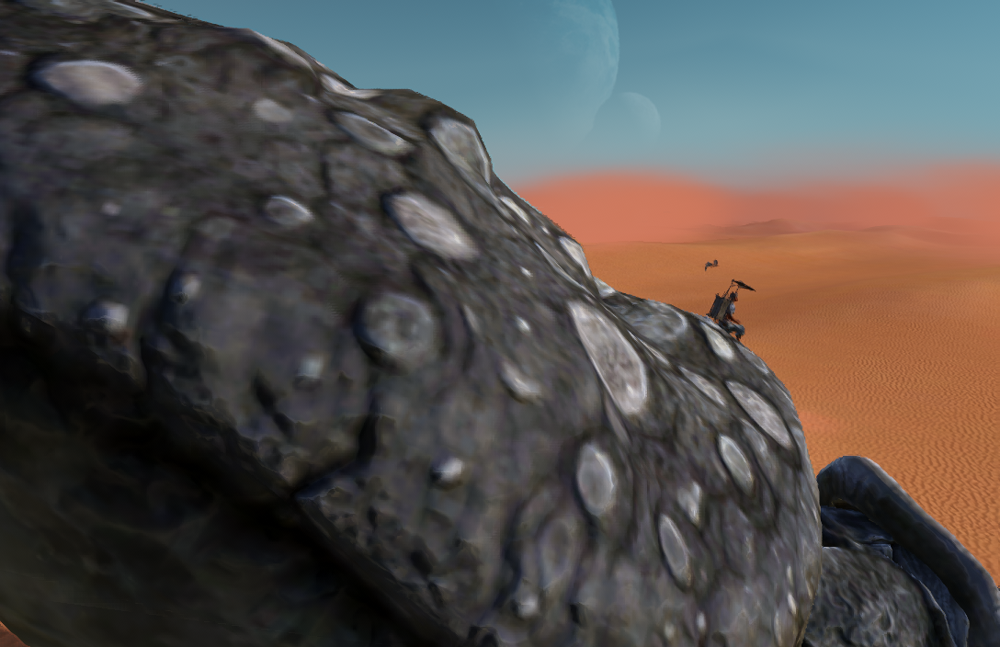

# Meitou v0.22.1 compatibility pass

Tested on Windows x64 with official MeitouClient `0.22.1+9ee4074bbc6fd7fdeb26108a04afc9f90cb1dc01`, published Transport **v0.3.0-playtest.6**, and SDK 11.0.100. Every installed framework file was compared with its release ZIP. [Framework provenance](evidence/v0221/framework-provenance.json).

## Four-worker roster

| Check | Observed result |
| --- | --- |
| Primary animal records | 43/43 passed mount, movement, turn and dismount |
| Distinct fit definitions | 22/22 exercised |
| Younger repeats | Crab, Goat and Bonedog passed |
| Posed frames / turn frames, including younger repeats | 1243 / 432 |
| Largest rendered pelvis error | 0.02376087 world units |
| Largest saddle-origin error | 0.00873485 world units |
| Primary heading changes | 82.57 to 103.29 degrees |
| Save, reload, remount and ordinary on-foot movement | Bagged Pack Beast, bareback Goat and stock Pack Bull passed |
| Unowned registered Garru | Refused; rider remained selected |

Both position limits were strictly below **0.08 world units**. The observer independently reads the posed carrier bone, rider pelvis and submitted saddle, and checks facing, rider scale, native anchor identity and saddle count. Bareback cases require zero saddle meshes. The Pack Beast kept its Garru Backpack (`4002-gamedata.base`), including four Animal Skins transferred into its contents by an ordinary inventory command, across save/reload. The stock Wandering Trader's Pack Bull kept its Bull Backpack (`43948-rebirth.mod`).

[43-row current measurements](evidence/v0221/roster.csv) · [All 46 ride observations](evidence/v0221/rides.json) · [Summary](evidence/v0221/summary.json).

Most cases use exact stock animal records placed in an owned fixture squad outside Stoat. The trader case uses the unmodified **The Wandering Trader** start at its normal location; its turn was 82.57 degrees. The fixture does not ship with the player pack. Pack Beast Dead is tested as a living instance of its stock record, not as a rideable corpse. These checks do not grant ownership of wild animals.

## One-worker packaged-ZIP check

The final five-file player ZIP was installed in a fresh profile and the bagged Pack Beast and bareback Goat repeated mount, turn, save, reload, remount, dismount and ordinary on-foot movement with one simulation worker. Both passed, including unchanged bags/cargo. Maximum rider error was 0.01610600 and saddle error 0.00873485 world units. [Measurements](evidence/v0221/one-worker.json).

These agree with the four-worker runs on acceptance outcomes. This live test does not claim identical tick hashes or frame timing between worker counts.

## Visual review

The remaining two fits are the largest bodies:

Fit settings and art were preserved, not polished in this compatibility pass. Small carriers can put a human's feet near the ground or front legs. Fur, shells, spines and stock bags obscure parts of the rider. The Leviathan remains a rough shoulder perch, and its bulk obstructs the camera. Cleanser Unit initially required an approach from another side before mounting. A passing numerical attachment check does not certify every animated pose as clipping-free.

[Bagged Pack Beast](evidence/v0221/pack-beast.png) · [Bareback Goat](evidence/v0221/goat.png) · [Stock Pack Bull](evidence/v0221/pack-bull.png).

## Pack identity and publication status

The original four runtime files are byte-identical to the earlier Maestro export. All pack/fit IDs, target records and filenames remain unchanged. The original `.mod` has one dependency, Meitou Transport.mod, and zero record overrides. The new reproducible player ZIP adds only CC0-1.0.txt. SHA-256: `67c13ef9af412b799d4520ed55a541d617fcace2a6bae741e7819e8ecab3c53f`.

The repository holds the editable mod, GPL verification/packaging tools, CC0 original data/art/guides and selected evidence. Raw saves, game assemblies and trial installations remain local. [Historical v0.18.0/local-native evidence](evidence/historical/README.md) is labeled separately. Workshop upload, subscription-path testing and publication have not been performed.
